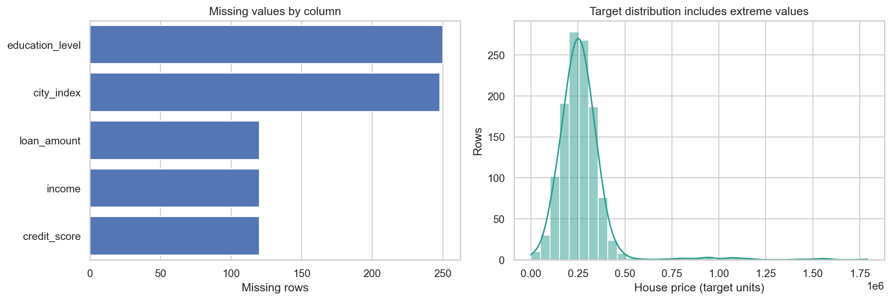

<p align="center">
  
</p>

<h1 align="center">AI & Machine Learning Portfolio</h1>

<p align="center">
  Practical, reproducible projects across machine learning, deep learning, NLP, generative AI, and prompt engineering.
</p>

<p align="center">
  
  
  
  
  
</p>

## About this portfolio

This repository is a growing collection of end-to-end AI projects. Each project is designed to show more than a notebook: it includes a clear problem statement, reproducible code, measurable results, limitations, tests, and instructions for running the work locally.

The emphasis is on honest evaluation and engineering discipline. When a dataset does not support a strong model, the project reports that result instead of presenting misleading accuracy.

## Projects by category

### Machine Learning

| Project | What it demonstrates | Result | Status |
|---|---|---|---|
| [House Price Prediction](projects/machine-learning/house-price-prediction) | Data-quality audit, leakage-safe preprocessing, cross-validation, model serialization, CLI inference, tests, and CI | Median baseline selected; holdout R² `-0.002`, revealing insufficient predictive signal | Complete baseline |

[Browse all Machine Learning projects →](projects/machine-learning)

### Deep Learning

Neural networks, computer vision, transfer learning, and experiment tracking projects will be organized here.

[Browse Deep Learning projects →](projects/deep-learning)

### Generative AI

RAG systems, LLM evaluation, guardrails, agents, and prompt-engineering projects will be organized here.

[Browse Generative AI projects →](projects/generative-ai)

### Natural Language Processing

Text classification, embeddings, semantic search, and information-extraction projects will be organized here.

[Browse NLP projects →](projects/nlp)

## House Price Prediction

<p align="center">
  
</p>

The first project converts an error-prone neural-network notebook into a reproducible regression repository. It fixes a column-filtering bug, removes preprocessing leakage, replaces deprecated code, compares multiple estimators, packages a trained artifact, and documents why the available data cannot support a useful production predictor.

**Technical highlights**

- Built a reusable scikit-learn preprocessing and regression pipeline.
- Evaluated candidates with shuffled five-fold cross-validation and an untouched holdout set.
- Added model metadata, batch inference, automated tests, and GitHub Actions.
- Documented model limitations and dataset provenance risks in a dedicated model card.
- Preserved the statistically honest result: more model complexity did not overcome weak input data.

[Explore the project →](projects/machine-learning/house-price-prediction/README.md)

## How projects are organized

Every project belongs to one primary category so recruiters and reviewers can quickly find the relevant work. Prompt-engineering projects that evaluate or operate LLMs live under Generative AI; language-modeling and classical text-analysis projects live under NLP. New projects are added only when they are runnable and documented.

## Repository structure

```text
ai-ml-portfolio/
├── .github/workflows/        # Automated quality checks
├── assets/                   # Portfolio visuals
├── projects/
│   ├── machine-learning/
│   │   └── house-price-prediction/
│   │       ├── data/
│   │       ├── models/
│   │       ├── notebooks/
│   │       ├── reports/figures/
│   │       ├── src/
│   │       └── tests/
│   ├── deep-learning/
│   ├── generative-ai/
│   └── nlp/
├── CONTRIBUTING.md
└── PROJECT_TEMPLATE.md
```

## Quality standard

Every project added to this portfolio should include:

- A concise business or research problem.
- Reproducible setup and execution instructions.
- Traceable data provenance and license information.
- A baseline and appropriate evaluation metrics.
- Clear visual evidence and interpretation.
- Tests for important code paths.
- Honest limitations, failure cases, and next steps.
- A résumé-ready project summary grounded in measured results.

## Run the current project

```bash
cd projects/machine-learning/house-price-prediction
python -m venv .venv
```

Activate the environment and run:

```bash
python -m pip install -r requirements-dev.txt
python -m src.train
python -m pytest
python -m src.predict --input example_input.json
```

## Résumé-ready description

> Re-engineered a house-price regression notebook into a reproducible ML project with leakage-safe preprocessing, five-fold model comparison, holdout evaluation, serialized inference, automated testing, and CI. Diagnosed insufficient feature signal through a negative holdout R² and documented the model's limitations instead of overstating performance.

## Notes

- The included dataset has no documented source or redistribution license. Verify publishing rights before keeping it in a public repository.
- The current model is a research baseline and must not be used for appraisal, lending, or financial decisions.
- A software license has not been selected. Add one only after choosing the terms under which others may reuse the code.
